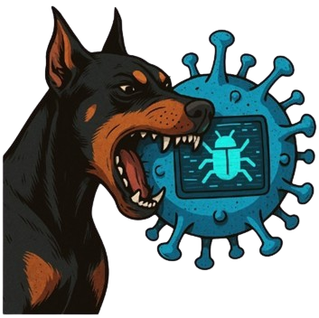

# WatchDog: Sistema de Resposta a Incidentes (Runbook CLI)

<div align="center">
  
</div>

## Descrição do Projeto

O **WatchDog** é uma ferramenta de linha de comando (CLI) desenvolvida em Python para auxiliar analistas de segurança em um Centro de Operações de Segurança (SOC) na resposta a incidentes.
O projeto tem como objetivo principal demonstrar a execução de **runbooks** e também sua criação automática, através do Google Gemini.
Além disso, o projeto disponibiliza um módulo de análise de logs para detecção de ameaças.

A ferramenta é modular e extensível. Ela carrega dinamicamente runbooks que são scripts Python independentes, permitindo que a equipe de segurança crie e adicione novos guias de resposta de acordo com as ameaças que surgirem.
Para efeito de demonstração, atualmente o WatchDog inclui runbook para a seguinte ameaça:

-   **XWorm:** Remote Access Trojan (RAT) desenvolvido em .NET, vendido em fóruns de cibercrime.

Ao final da execução de cada runbook, a ferramenta oferece a opção de gerar um relatório detalhado em formato PDF, consolidando as ações tomadas durante o processo de mitigação.

## Funcionalidades

-   **Menu Interativo:** Interface de linha de comando intuitiva para navegação.
-   **Runbooks Modulares:** Capacidade de adicionar novos runbooks facilmente.
-   **Guias Passo a Passo:** Conduz o analista de segurança por cada etapa da resposta a um incidente.
-   **Análise de Logs x Indicadores (IoC):** Correlaciona indicadores de ameaça com logs de detecção e e-mail para identificar ameaças.
-   **Geração de Runbooks por IA:** Utiliza a API do Google Gemini para criar novos runbooks automaticamente.
-   **Geração de Relatórios:** Criação de um relatório em PDF com o registro das ações e o resultado da execução.
-   **Foco em Processo:** O projeto prioriza a lógica de um fluxo de trabalho de resposta a incidentes, sem a necessidade de infraestrutura complexa ou bancos de dados.

## Instalação e Uso

### Pré-requisitos

Certifique-se de ter o Python 3.6 ou superior instalado em seu sistema.

### Instalação

1.  **Clone o repositório:**
    ```bash
    git clone https://github.com/mthzo/watchdog.git
    cd watchdog
    ```

### Configuração do Ambiente Virtual

É **altamente recomendado** usar um ambiente virtual para gerenciar as dependências do projeto. Isso evita conflitos com outras bibliotecas instaladas em seu sistema.

1.  **Crie o ambiente virtual** na pasta raiz do projeto:
    ```bash
    python -m venv .venv
    ```

2.  **Ative o ambiente virtual:**
    * **No Windows (PowerShell):**
        ```bash
        .venv\Scripts\activate
        ```
    * **No macOS e Linux:**
        ```bash
        source .venv/bin/activate
        ```

    > **Nota para usuários Windows:** Se a ativação falhar com um erro de política de execução (`UnauthorizedAccess`), você precisará ajustar a política apenas para o seu usuário. Abra o PowerShell **como administrador** e execute o seguinte comando:
    >
    > ```bash
    > Set-ExecutionPolicy -ExecutionPolicy RemoteSigned -Scope CurrentUser
    > ```
    >
    > Após isso, feche o PowerShell e tente o comando de ativação novamente em uma nova janela.

### Instalação de Dependências

Com o ambiente virtual ativo, instale as bibliotecas abaixo:
```bash
pip install pandas fpdf2 python-dotenv google-generativeai
```

### Configuração Google Gemini

Para usar a funcionalidade de geração de runbooks por IA, você precisará de uma **chave de API para o Google Gemini**.

1.  **Obtenha sua chave de API**: Acesse o [Google AI Studio](https://aistudio.google.com/app/apikey), faça login com sua conta Google e gere uma nova chave de API.

2.  **Crie um arquivo** `.env`: Na pasta raiz do projeto, crie um arquivo chamado `.env`.

3.  **Adicione a chave de API**: Dentro do arquivo `.env`, adicione sua chave no seguinte formato:
    ```bash
    GEMINI_API_KEY="SUA_CHAVE_DE_API_AQUI"
    ```
    Substitua `"SUA_CHAVE_DE_API_AQUI"` pela sua chave real.

    **Importante:** O arquivo `.env` deve ser ignorado pelo Git para garantir que sua chave de API não seja exposta. Certifique-se de que a linha `.env` esteja presente em seu arquivo `.gitignore`.

### Como Executar

1. Execute o script principal diretamente do terminal (com o ambiente virtual ativo):

```bash
python watchdog.py
```

2. Siga as instruções do menu para selecionar a funcionalidade que deseja usar.

## Contribuição

Sinta-se à vontade para contribuir com este projeto, seja adicionando novos runbooks, aprimorando a interface ou corrigindo bugs.

**Faça um fork do projeto.**

Crie uma nova branch para a sua feature (git checkout -b feature/minha-nova-feature).

Faça o commit das suas alterações (git commit -m 'feat: adicionando nova funcionalidade').

Envie suas alterações (git push origin feature/minha-nova-feature).

**Abra um Pull Request.**